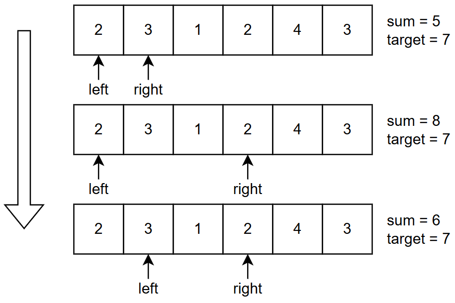

# 非定长滑动窗口

***

## 一、概念与特征

### 1.1 定义

非定长滑动窗口(又称「可变长滑动窗口」、「不定长滑动窗口」、「双指针同向扫描」)是滑动窗口类算法的一个子分支。它在保持窗口内元素随下标连续移动这一基本性质的前提下,允许窗口的左右边界 `left`、`right` 之间的距离根据当前窗口内状态的变化而动态伸缩,而不像定长滑动窗口那样要求窗口长度始终保持为某个固定常数 `k`。

其基本动作是:外层循环不断向右推进 `right` 端点以扩大窗口,当窗口内的状态满足(或不再满足)题目要求的「合法性」条件时,内层循环主动把 `left` 端点向右收缩,使窗口维持在「恰好/最接近合法」的状态;每一步状态变化时,依据题目所求是「最长」「最短」还是「个数」,用 `max` / `min` / 计数公式对当前窗口做一次答案贡献。本质上,它是把「满足约束的最优/合法连续子数组」问题,转化为对单调不变量(如前缀和、计数桶)在窗口边界移动时的 `O(1)` 维护。

### 1.2 适用场景识别

在题目中遇到以下强信号时,通常可以直接判题「用非定长滑动窗口」:

- **连续子数组 / 子串** 这类限定词明确出现,而不是「子序列」或不要求连续。
- 元素具有**单调可加性**:正整数数组(求和只会越加越大)、单调递增 / 递减序列、按位计数可累加的桶等;只要窗口扩张不会让约束往反方向变化,滑动窗口就成立。
- 约束条件是「满足某阈值」「频次不超过 K」「最多 K 种不同元素」「某种字符全部覆盖」等**单调可比较**的性质,即:窗口变大不会让「合法」反向变「非法」、窗口缩小也不会让「非法」反向变「合法」。
- 题目问「**最长/最大/最短/最小/个数**」,且答案的**单调性**与窗口长度的单调性之间有明确对应关系(越长越合法 → 求最短;越短越合法 → 求最长或求个数;恰好型 → 用 atMost(K) - atMost(K-1) 差分)。
- 题目中存在「**能否再缩小/扩大**」的可验证判据:每步能 `O(1)` 回答「把 left 右移一格,约束是否仍满足 / ans 是否能更优」。

反之,如果题目中给的数组元素包含负数,由于和不再随窗口扩张单调,直接滑动窗口失效,需改用前缀和 + 哈希表等方案。

### 1.3 与其他算法的关系

非定长滑动窗口处于一个被「**同向双指针**」框架包住的生态位,和以下算法有清晰的边界与联系:

- **vs 定长滑动窗口**:两者共享「左右指针同向移动、每个元素最多进出窗口一次」的工程骨架,差别只在窗口长度是否被固定。定长窗口的「出窗口」时机由 `right - left + 1 == k` 决定,非定长窗口的「出窗口」时机由「约束被破坏 / 已找到更优解」决定。
- **vs 前缀和 + 哈希表**:两者常在「求恰好 K 个 / 求和为 K 的子数组个数」这一类题目上互换。当窗口内值随扩张单调(如元素非负),滑动窗口更省空间、更快;当元素含负数、窗口内和不再单调时,必须改用前缀和 + 哈希表计数。
- **vs 同向双指针(一般意义)**:所有滑动窗口都是同向双指针;反之不成立。同向双指针还可以解决「合并有序数组」「去重」「原地移动零」等问题,这些场景并不维护一个「窗口状态」,因此不能称为滑动窗口。
- **vs 单调队列 / 单调栈**:当需要维护「窗口内最大值 / 最小值 / 严格大于某值的最远位置」时,滑动窗口 + 单调队列(或单调栈)联合使用,可以同时解决「按值约束」与「按极值约束」两个维度。

***

## 二、题型分类

| 分类     | 典型问题           | 窗口内维护的状态                                | 代表题                                                                                           |
| ------ | -------------- | --------------------------------------- | --------------------------------------------------------------------------------------------- |
| 求最长子数组 | 寻找满足约束的最长连续区间  | 窗口尽量"装满"满足条件的元素,条件被破坏则收缩（一般是while外更新答案） | [3. 无重复字符的最长子串](https://leetcode.cn/problems/longest-substring-without-repeating-characters/) |
| 求最短子数组 | 寻找满足约束的最短连续区间  | 窗口"刚好满足"条件时即尝试收缩并更新答案（一般是while内收缩前更新答案） | [209. 长度最小的子数组](https://leetcode.cn/problems/minimum-size-subarray-sum/)                      |
| 求子数组个数 | 统计满足约束的连续子数组总数 | 根据题目要求维护窗口状态,统计"合法子数组数量"                | [713. 乘积小于 K 的子数组](https://leetcode.cn/problems/subarray-product-less-than-k/)                |

***

## 三、核心套路总结

### 3.1 套路

非定长滑动窗口的几乎所有题型,都可以拆解为「**扩 — 验 — 缩 / 计**」三步走:

1. **扩(advance right)**:外层循环把 `right` 端点向右移动一格,把新进入窗口的元素按业务语义更新到「窗口状态」中(累加和、计数桶、最值结构等)。这一步是「无脑前进」—— 无论窗口当前是否合法,先把它纳入考虑。
2. **验(validate / commit)**:在窗口刚扩张后,判断当前窗口是否满足题目要求的「合法性」条件,或是否已具备「**更新答案**」的资格(例如:`sum >= target` 时可更新最短长度;新增的合法子数组个数为 `right - left + 1`)。这一步是「**算账**」。
3. **缩(shrink left)**:若窗口已**越过**合法性边界(再也无法更优或已确定不再合法),用 `while` 循环把 `left` 端点不断右移,每移一格都把对应元素从「窗口状态」中扣除;直到窗口再次「**临界合法**」(或不合法时立刻停下)。这一步是「**减负**」,也是非定长窗口区别于定长窗口的关键 —— 收缩逻辑因题而异。

对于「**求个数**」类题目,第三步往往不是单纯收缩,而是「在临界合法时,一次性结算 `right - left + 1` 个以 `right` 结尾的子数组,然后整体前移」,这是把「缩」与「计」合二为一的写法,本质仍是同一个三步走的变形。

### 3.2 常见维护变量

- **`sum`** **/** **`product`** **/** **`xor`** 等「聚合量」:窗口内元素的某种可累加/可异或的合并结果;最常用于「子数组和 / 积 / 异或值」类约束。
- **`count[ch]`** **/** **`cnt[x]`**(频次桶,通常用 `int[26]`、`int[128]`、`unordered_map<int, int>` 实现):统计窗口内每种元素出现的次数;用于「最多 K 种不同」「某字符全部覆盖」「频次不超过 K」等约束。
- **`distinct`** **/** **`kinds`**:窗口内「不同元素种数」,由频次桶变化时同步维护(进入元素时若原频次为 0 则 +1,离开元素时若频次降为 0 则 -1)。
- **`satisfy`** 或 **`valid_mask`**:窗口内某类约束被「满足」的程度;最常用在「恰好 K 种」差分场景,记录「至少多少种已覆盖 / 已达标」。
- **`left`,** **`right`,** **`ans`,** **`n`**:框架层变量,分别表示窗口左右端、当前最优解、数组长度。
- **(进阶)`deque`** **/ 单调栈**:维护「窗口内最大/最小值」或「下一个更大/更小元素的位置」;与上述变量并存。

### 3.3 初始化时机

- 窗口左右端点一般初始化为 `left = 0, right = 0`,代表「当前窗口为空」。
- 聚合量 `sum` 初始化为 `0`;频次桶 / 哈希表在使用前**不必**预先放入任何元素(空窗口本身就是合法起点)。
- **「求最短」类**:`ans` 初始化为 `n + 1`(数组长度加 1)或 `INT_MAX` 这种「明显大于合法答案」的占位值,作为「尚未找到」与「最终答案」的统一约定,末尾再用 `ans <= n ? ans : 0`(或其他无解判据)返回。
- **「求最长」类**:`ans` 初始化为 `0`,每步 `ans = max(ans, right - left + 1)`。
- **「求个数」类**:`ans` 初始化为 `0` 或 `0LL`(若结果可能溢出),在窗口临界合法时,根据题目的计数公式(常见 `right - left + 1`、`atMost(K) - atMost(K-1)` 差分等)累加。
- **「恰好 K」差分类**:`ans = atMost(K) - atMost(K-1)`,两个子函数各自维护自己的窗口;`atMost(0)` 在「和为 0 的子数组」这类问题里常要预先在哈希表中放入 `{0: 1}`(代表「空前缀」),否则会漏掉以 `0` 开头的子数组。

***

## 四、典型例题

### 例题: [209. 长度最小的子数组](https://leetcode.cn/problems/minimum-size-subarray-sum/)

> 给定一个含有 n 个正整数的数组和一个正整数 target 。
> 找出该数组中满足其总和大于等于 target 的长度最小的 子数组 \[numsl, numsl+1, ..., numsr-1, numsr] ，并返回其长度。如果不存在符合条件的子数组，返回 0 。

**思路**: 满足条件为子数组总和大于等于 target，由于数组Nums中的元素为正整数，所以子数组的总和为递增的，我们可以使用滑动窗口来维护一个子数组，当子数组的总和大于等于 target时，尝试收缩左侧窗口端点，更新答案；当子数组的总和小于 target时，继续向右扩展窗口。

观察图中示例可知，窗口大小为 `right - left + 1`，当满足题目条件时，用 `min(ans, right - left + 1)` 更新答案。

我们可以统一约定用for循环嵌套while循环来实现，右端点的扩展交给for循环，左端点的收缩交给while循环，for循环不在意窗口是否满足条件，只管把 `right` 指针向右移动直到数组上限，而while循环要考虑的就多了，需要判断窗口是否满足条件，如果满足条件，就更新答案，然后收缩左侧窗口端点，直到窗口不满足条件。

```cpp
class Solution {
public:
    int minSubArrayLen(int target, vector<int>& nums) {
        int sum = 0, ans = nums.size() + 1;
        int left = 0;
        
        //for循环：扩展右端点
        for(int right = 0; right < nums.size(); right++){
            sum += nums[right];
            //while循环：更新答案、收缩左端点
            while(sum >= target){
                ans = min(ans, right - left + 1);
                sum -= nums[left];
                left++;
            }
        }

        return ans <= nums.size() ? ans : 0;
    }
};
```

- **时间复杂度**: O(n)，其中 n 为 nums 的长度。虽然写了个二重循环，但是内层循环中对 left 加一的总执行次数不会超过 n 次，所以总的时间复杂度为 O(n)。
- **空间复杂度**: O(1)

***

## 五、易错点与边界

1. 一个循环防止数组越界，另一个循环负责确认答案条件。
2. 本题的窗口是左闭右闭区间，所以窗口大小为 `right - left + 1`。
3. 本题初始化 `ans` 为 `nums.size() + 1`，因为题目要求子数组的长度最小，所以答案初始值设为大于数组长度的数，方便后续更新，如最终答案为改变，说明不存在符合条件的子数组，最终返回 0。

***

## 六、复杂度分析

- **时间复杂度**: `O(n)`,其中 `n` 是数组 / 字符串长度。尽管代码上常写成「外层 `for` + 内层 `while`」的二重循环,但 `right` 单调递增至 `n`,`left` 也单调递增至 `n`,每个元素最多进入窗口一次、离开窗口一次,所有 `while` 循环对 `left` 加 1 的总执行次数不超过 `n` 次,故总和为线性。
- **空间复杂度**: `O(1)` 或 `O(k)`(频次桶 / 哈希表占用)。若仅维护 `sum` 之类的聚合量,为 `O(1)`;若维护「不同元素种类」「字符频次」等桶,空间与「窗口内不同值的上界」相关,通常为 `O(k)`,`k` 为字符集大小(如 `26`)、种类上界(如 `K`)、或出现过的不同元素数(≤ `n`)。

***

## 七、练习题清单

### 1. 越短越合法 / 求最长 / 最大

#### 1.1 基础

| 难度 | 题目                                                                                                     | 题号   | 题解 |
| -- | ------------------------------------------------------------------------------------------------------ | ---- | -- |
| 中等 | [无重复字符的最长子串](https://leetcode.cn/problems/longest-substring-without-repeating-characters/) | 3    | [题解](../../leetcode/sliding-window/3-leetcode.md) |
| 简单 | [每个字符最多出现两次的最长子字符串](https://leetcode.cn/problems/maximum-length-substring-with-two-occurrences/)       | 3090 | [题解](../../leetcode/sliding-window/3090-leetcode.md) |
| 中等 | [删掉一个元素以后全为 1 的最长子数组](https://leetcode.cn/problems/longest-subarray-of-1s-after-deleting-one-element/) | 1493 | [题解](../../leetcode/sliding-window/1493-leetcode.md) |
| 中等 | [使数组平衡的最少移除数目](https://leetcode.cn/problems/minimum-removals-to-balance-array/)                        | 3634 | -  |
| 中等 | [尽可能使字符串相等](https://leetcode.cn/problems/get-equal-substrings-within-budget/)                          | 1208 | -  |
| 中等 | [水果成篮](https://leetcode.cn/problems/fruit-into-baskets/)                                               | 904  | -  |
| 中等 | [删除子数组的最大得分](https://leetcode.cn/problems/maximum-erasure-value/)                                      | 1695 | -  |
| 中等 | [最多 K 个重复元素的最长子数组](https://leetcode.cn/problems/length-of-longest-subarray-with-at-most-k-frequency/)  | 2958 | -  |
| 中等 | [考试的最大困扰度](https://leetcode.cn/problems/maximize-the-confusion-of-an-exam/)                            | 2024 | -  |
| 中等 | [最大连续 1 的个数 III](https://leetcode.cn/problems/max-consecutive-ones-iii/)                               | 1004 | -  |

#### 1.2 进阶

| 难度 | 题目                                                                                                       | 题号   | 题解 |
| -- | -------------------------------------------------------------------------------------------------------- | ---- | -- |
| 中等 | [找到最长的半重复子字符串](https://leetcode.cn/problems/find-the-longest-semi-repetitive-substring/)                 | 2730 | -  |
| 中等 | [数组的最大美丽值](https://leetcode.cn/problems/maximum-beauty-of-an-array-after-applying-operation/)            | 2779 | -  |
| 中等 | [将 x 减到 0 的最小操作数](https://leetcode.cn/problems/minimum-operations-to-reduce-x-to-zero/)                  | 1658 | -  |
| 中等 | [最高频元素的频数](https://leetcode.cn/problems/frequency-of-the-most-frequent-element/)                         | 1838 | -  |
| 中等 | [每种字符至少取 K 个](https://leetcode.cn/problems/take-k-of-each-character-from-left-and-right/)                | 2516 | -  |
| 中等 | [找出最长等值子数组](https://leetcode.cn/problems/find-the-longest-equal-subarray/)                               | 2831 | -  |
| 中等 | [毯子覆盖的最多白色砖块数](https://leetcode.cn/problems/maximum-white-tiles-covered-by-a-carpet/)                    | 2271 | -  |
| 困难 | [摘水果](https://leetcode.cn/problems/maximum-fruits-harvested-after-at-most-k-steps/)                      | 2106 | -  |
| 中等 | [两个线段获得的最多奖品](https://leetcode.cn/problems/maximize-win-from-two-segments/)                              | 2555 | -  |
| 困难 | [使数组连续的最少操作数](https://leetcode.cn/problems/minimum-number-of-operations-to-make-array-continuous/)       | 2009 | -  |
| 困难 | [可见点的最大数目](https://leetcode.cn/problems/maximum-number-of-visible-points/)                               | 1610 | -  |
| 困难 | [最长合法子字符串的长度](https://leetcode.cn/problems/length-of-the-longest-valid-substring/)                       | 2781 | -  |
| 简单 | [最长乘积等价子数组](https://leetcode.cn/problems/maximum-subarray-with-equal-products/)                          | 3411 | -  |
| 中等 | [收集连续 K 个袋子可以获得的最多硬币数量](https://leetcode.cn/problems/maximum-coins-from-k-consecutive-bags/)             | 3413 | -  |
| 中等 | [至少有 K 个重复字符的最长子串](https://leetcode.cn/problems/longest-substring-with-at-least-k-repeating-characters/) | 395  | -  |
| 简单 | [最长的美好子字符串](https://leetcode.cn/problems/longest-nice-sUbstring/)                                        | 1763 | -  |
| 困难 | [执行操作使频率分数最大](https://leetcode.cn/problems/apply-operations-to-maximize-frequency-score/)                | 2968 | -  |
| 中等 | [移动石子直到连续 II](https://leetcode.cn/problems/moving-stones-until-consecutive-ii/)                          | 1040 | -  |

### 2. 越长越合法 / 求最短 / 最小

| 难度 | 题目                                                                                                        | 题号   | 题解 |
| -- | --------------------------------------------------------------------------------------------------------- | ---- | -- |
| 中等 | [长度最小的子数组](https://leetcode.cn/problems/minimum-size-subarray-sum/)                                       | 209  | 例题 |
| 中等 | [不同元素和至少为 K 的最短子数组长度](https://leetcode.cn/problems/minimum-subarray-length-with-distinct-sum-at-least-k/) | 3795 | [题解](../../leetcode/sliding-window/3795-leetcode.md) |
| 中等 | [最短且字典序最小的美丽子字符串](https://leetcode.cn/problems/shortest-and-lexicographically-smallest-beautiful-string/) | 2904 | [题解](../../leetcode/sliding-window/2904-leetcode.md) |
| 中等 | [替换子串得到平衡字符串](https://leetcode.cn/problems/replace-the-substring-for-balanced-string/)                    | 1234 | -  |
| 中等 | [无限数组的最短子数组](https://leetcode.cn/problems/minimum-size-subarray-in-infinite-array/)                       | 2875 | -  |
| 困难 | [最小覆盖子串](https://leetcode.cn/problems/minimum-window-substring/)                                          | 76   | -  |
| 困难 | [最小区间](https://leetcode.cn/problems/smallest-range-covering-elements-from-k-lists/)                       | 632  | -  |

### 3. 求子数组个数

#### 3.1 越短越合法

| 难度 | 题目                                                                                               | 题号     | 题解 |
| -- | ------------------------------------------------------------------------------------------------ | ------ | -- |
| 中等 | [乘积小于 K 的子数组](https://leetcode.cn/problems/subarray-product-less-than-k/)                        | 713    | -  |
| 简单 | [统计满足 K 约束的子字符串数量 I](https://leetcode.cn/problems/count-substrings-that-satisfy-k-constraint-i/) | 3258   | -  |
| 困难 | [统计得分小于 K 的子数组数目](https://leetcode.cn/problems/count-subarrays-with-score-less-than-k/)          | 2302   | -  |
| 中等 | [不间断子数组](https://leetcode.cn/problems/continuous-subarrays/)                                     | 2762   | -  |
| 中等 | [美观的花束](https://leetcode.cn/problems/1GxJYY/)                                                    | LCP 68 | -  |

#### 3.2 越长越合法

| 难度 | 题目                                                                                                                        | 题号   | 题解 |
| -- | ------------------------------------------------------------------------------------------------------------------------- | ---- | -- |
| 中等 | [包含所有三种字符的子字符串数目](https://leetcode.cn/problems/number-of-substrings-containing-all-three-characters/) | 1358 | [题解](../../leetcode/sliding-window/1358-leetcode.md) |
| 中等 | [统计最大元素出现至少 K 次的子数组](https://leetcode.cn/problems/count-subarrays-where-max-element-appears-at-least-k-times/) | 2962 | [题解](../../leetcode/sliding-window/2962-leetcode.md) |
| 中等 | [字符至少出现 K 次的子字符串 I](https://leetcode.cn/problems/count-substrings-with-k-frequency-characters-i/)                         | 3325 | -  |
| 简单 | [统计字符串中的元音子字符串](https://leetcode.cn/problems/count-vowel-substrings-of-a-string/)                                         | 2062 | -  |
| 中等 | [统计完全子数组的数目](https://leetcode.cn/problems/count-complete-subarrays-in-an-array/)                                          | 2799 | -  |
| 中等 | [统计好子数组的数目](https://leetcode.cn/problems/count-the-number-of-good-subarrays/)                                             | 2537 | -  |
| 困难 | [统计重新排列后包含另一个字符串的子字符串数目 II](https://leetcode.cn/problems/count-substrings-that-can-be-rearranged-to-contain-a-string-ii/) | 3298 | -  |

#### 3.3 恰好型滑动窗口

| 难度 | 题目                                                                                                           | 题号   | 题解 |
| -- | ------------------------------------------------------------------------------------------------------------ | ---- | -- |
| 中等 | [和相同的二元子数组](https://leetcode.cn/problems/binary-subarrays-with-sum/)                                         | 930  | [题解](../../leetcode/sliding-window/930-leetcode.md) |
| 中等 | [统计「优美子数组」](https://leetcode.cn/problems/count-number-of-nice-subarrays/)                                    | 1248 | [题解](../../leetcode/sliding-window/1248-leetcode.md) |
| 中等 | [元音辅音字符串计数 II](https://leetcode.cn/problems/count-of-substrings-containing-every-vowel-and-k-consonants-ii/) | 3306 | -  |
| 困难 | [K 个不同整数的子数组](https://leetcode.cn/problems/subarrays-with-k-different-integers/)                             | 992  | -  |
| 困难 | [统计包含 K 个不同整数的子数组](https://leetcode.cn/problems/count-subarrays-with-k-distinct-integers/)                   | 3859 | -  |

***

## 八、与其他算法对比

| 算法              | 窗口长度          | 典型操作                                              | 时间                      | 适用场景                                  |
| --------------- | ------------- | ------------------------------------------------- | ----------------------- | ------------------------------------- |
| 非定长滑动窗口         | 随约束动态伸缩       | 扩 — 验 — 缩,临界合法时按题目公式 `max` / `min` / 计数           | `O(n)`                  | 求最长/最短/个数的连续子数组(子串),且窗口内状态随扩张单调       |
| 定长滑动窗口          | 固定为 `k`       | 扩张 `right`、同步让 `left` 右移保持长度 `k`,固定时机 `O(1)` 更新答案 | `O(n)`                  | 窗口大小由题意直接给定,如「最近 K 个」「定长异或」「定长子串最大和」  |
| 前缀和 + 哈希表       | 不维护窗口,直接枚举右端点 | 在哈希表里查 `sum[j] - K` 的出现次数                         | `O(n)`                  | 元素含负数、窗口内和不单调;求「和等于 K 的子数组个数」         |
| 同向双指针(一般意义)     | 未必维护窗口状态      | 仅依靠指针移动做去重 / 合并 / 原地交换                            | 视场景而定 `O(n)` \~ `O(n²)` | 不强调「窗口状态」、只强调下标演进的场景                  |
| 单调队列 / 单调栈 + 窗口 | 同样可伸缩,叠加极值结构  | 在窗口扩张时同步维护单调队列,O(1) 拿最值                           | `O(n)`                  | 窗口内还要取「最大值 / 最小值 / 严格最值下标」,如「滑动窗口最大值」 |

